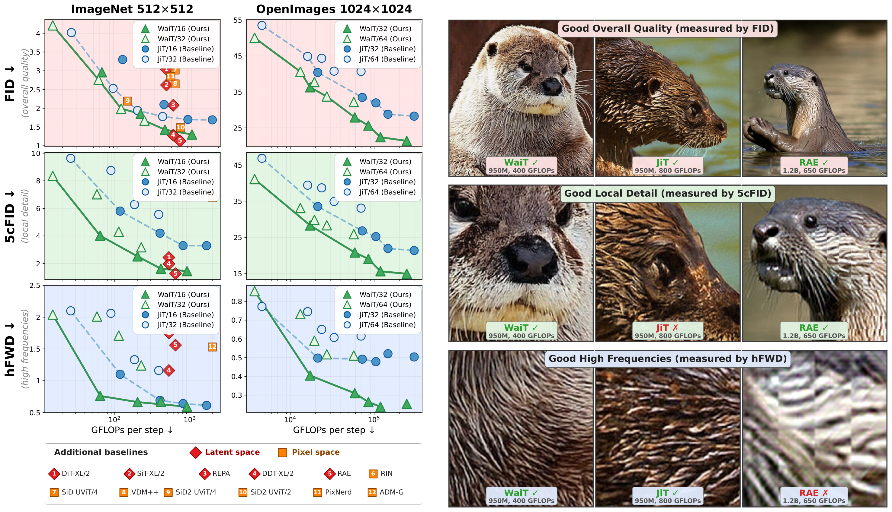
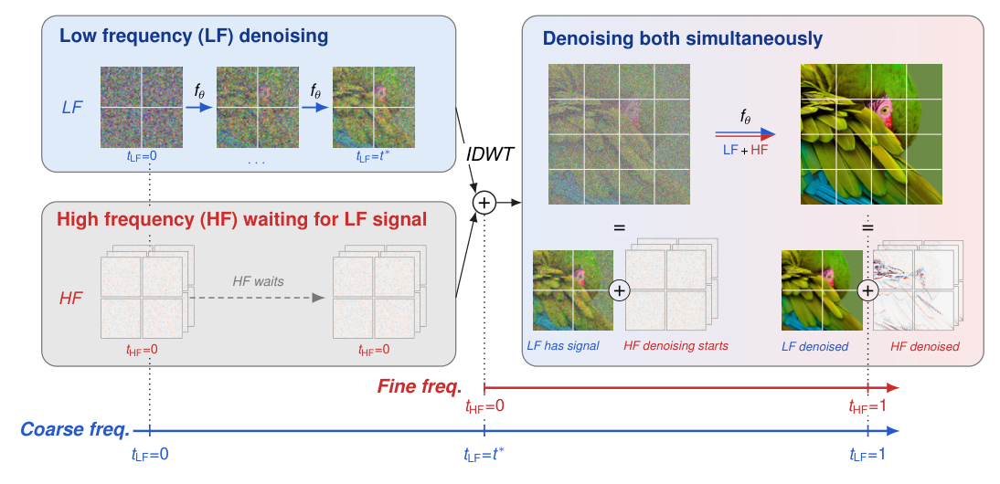

## WaiT for the Signal: Simple Frequency-Aware Flow-Matching

[](https://arxiv.org/abs/2607.28760)

<p align="center">
  
</p>

This is the official PyTorch/GPU implementation of the paper
[WaiT for the Signal: Simple Frequency-Aware Flow-Matching](https://arxiv.org/abs/2607.28760):

```
@article{pavasovic2026wait,
  title={WaiT for the Signal: Simple Frequency-Aware Flow-Matching},
  author={Pavasovic, Krunoslav Lehman and Vallaeys, Th{\'e}ophane and Mallat, St{\'e}phane and Biroli, Giulio and Zettlemoyer, Luke and Karrer, Brian and Verbeek, Jakob},
  journal={arXiv preprint arXiv:2607.28760},
  year={2026}
}
```

WaiT (Wavelet-aware image Transformer) is a pixel-space flow-matching transformer that gives the low-frequency (LF)
and high-frequency (HF) bands of a single-level Haar wavelet transform separate noise schedules:

```
t_LF = t,        t_HF = max(0, (t - t*) / (1 - t*))
```

For t < t* the HF bands are pure noise, so sampling starts on the LF band alone at half resolution. At t* the LF band
and fresh HF noise are combined with the inverse wavelet transform and denoised jointly in pixel space. A single
resolution-conditioned model serves both phases.

<p align="center">
  
</p>

This repository contains the code for class-conditional ImageNet generation. It builds on
[JiT](https://github.com/LTH14/JiT) and keeps its architecture, training recipe and x-prediction with v-loss.

### Dataset

Download [ImageNet](http://image-net.org/download) and place it in your `IMAGENET_PATH` (the folder that contains
`train/`).

### Installation

Download the code:

```
git clone https://github.com/facebookresearch/WaiT.git
cd WaiT
```

A suitable conda environment named `wait` can be created and activated with:

```
conda env create -f environment.yaml
conda activate wait
```

### Training

WaiT-B/16 on ImageNet 512x512 (effective batch size 1024):

```
torchrun --nproc_per_node=8 --nnodes=2 --node_rank=${NODE_RANK} \
--master_addr=${MASTER_ADDR} --master_port=${MASTER_PORT} \
main_wait.py \
--model WaiT-B/16 --img_size 512 \
--noise_scale_lf 1.5 --noise_scale_hf 1.0 --t_star 0.25 \
--batch_size 64 --blr 5e-5 --epochs 600 --warmup_epochs 5 \
--output_dir ${OUTPUT_DIR} --resume ${OUTPUT_DIR} \
--data_path ${IMAGENET_PATH}
```

Models are `WaiT-{B,L,XL,H,G}/{16,32}`; for H and G add `--attn_dropout 0.2 --proj_dropout 0.2`. On ImageNet we set
`--noise_scale_lf` to 1.5 x img_size / 512.

### Evaluation

```
torchrun --nproc_per_node=8 --nnodes=1 --node_rank=0 \
main_wait.py \
--model WaiT-B/16 --img_size 512 \
--noise_scale_lf 1.5 --noise_scale_hf 1.0 --t_star 0.25 \
--num_sampling_steps 50 --rho 0.6 --cfg 3.5 --interval_min 0.25 --interval_max 1.0 \
--gen_bsz 128 --num_images 50000 \
--ref_fid_path fid_stats/jit_in512_stats.npz \
--ref_5crop_path fid_stats/in512_train_5crop_stats.npz \
--ref_path fid_stats/in512_train_hfwd_stats.npz \
--output_dir ${CKPT_DIR} --resume ${CKPT_DIR} \
--data_path ${IMAGENET_PATH} --evaluate_gen
```

`--rho` is the fraction of sampling steps spent in the coarse phase; the settings of each model are listed in the
paper's appendix. Both EMAs are evaluated.

For FID and IS we use a customized [torch-fidelity](https://github.com/LTH14/torch-fidelity) with JiT's reference
statistics for ImageNet 256 and 512, available [here](https://github.com/LTH14/JiT/tree/main/fid_stats). 5-crop FID
(Inception features of the four corner and center 299x299 crops at native resolution) and hFWD (Frechet distance
between level-4 Haar wavelet packet coefficients, averaged over all packets except the lowest-frequency one) use
reference statistics computed once from the ImageNet training set:

```
python prepare_ref.py --data_path ${IMAGENET_PATH} --img_size 512 --split train --output_path fid_stats
```

### Contributing

See the [CONTRIBUTING](CONTRIBUTING.md) file for how to help out.

### License

WaiT is CC BY-NC 4.0 licensed, as found in the [LICENSE](LICENSE) file. Parts of the code are derived from
[JiT](https://github.com/LTH14/JiT) by Tianhong Li and Kaiming He, which is MIT licensed, as found in the
[LICENSE-JiT](LICENSE-JiT) file.

### Contact

For questions about the code or the paper, please open a GitHub issue or email krunolp@meta.com.
